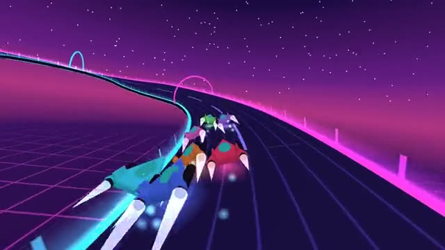

# Hover League

Neon hovercraft, banked turns, three laps. A multiplayer starter game from [Multiplayer Agent](https://multiplayeragent.com): 3D, versus, 2–8 players, with bots that fill empty seats.

## How it plays

Your craft thrusts on its own: steer through the banked turns and fly over the arrow pads for a boost. Air-brake to swing round tight corners. First over the line after three laps wins.

**Controls:** Arrow keys or A/D to steer, Shift or Down to air-brake, or on-screen buttons.

## Make it yours in the Game Builder

Open the [Game Builder](https://multiplayeragent.com), choose **Start from a starter game** and pick Hover League. It opens as version 1 in your studio, ready to play and publish. Then ask for changes, for example:

- Add a loop-the-loop to the track
- Add a shield pickup that blocks one bump
- Make it a desert canyon at sunset

## Run it yourself

1. Get a free publishable key (`pk_…`) at [multiplayeragent.com](https://multiplayeragent.com).
2. In `index.html`, put it in place of `pk_REPLACE_ME` in the `MP_CONNECT` block.
3. Serve the folder (for example `npx serve`) and open it. The 3D engine loads as a module, which browsers block from a file on disk.

Without a key it still runs, offline against bots.

## How it is built

- One `index.html` plus three.js in `libs/`. The comment at the top of the script maps the code and explains the multiplayer.
- The track is a list of points in `CONFIG.track`; the road, banking, rails and arches are all built from it. Boost pads are in `CONFIG.pads`.
- **Leaderboard:** The fastest laps on the track.
- **Host-run rounds:** The host's browser starts, ends and restarts each race; if it leaves, the next player takes over.
- **Bots:** Bots fill the grid until enough people join.
- **Live sync:** Every craft flies for everyone at once.
- `?attract` runs it offline with bots only. The preview video is recorded from it.

## License

MIT. three.js in `libs/` is MIT too (Copyright 2010-2024 three.js authors).
